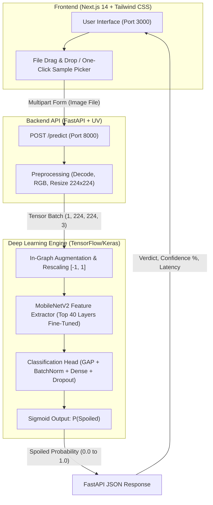

# 🍏 FruitGuard AI — Fruit Freshness Detection System

A production-ready Deep Learning computer vision platform that classifies fruits as **Fresh** or **Spoiled** with **99.84% accuracy** across 8 fruit species. Built with **MobileNetV2 Transfer Learning (TensorFlow/Keras)**, a high-throughput **FastAPI** backend, and a modern **Next.js 14 + Tailwind CSS** frontend dashboard.

---

## 🌟 Key Highlights

- **State-of-the-Art Accuracy:** **99.84% test accuracy** on 1,850 completely held-out test images (1,847/1,850 correct).
- **Zero Fresh Misclassifications:** **100% recall** on fresh fruits; **99.67% recall** on spoiled fruits.
- **8 Supported Fruit Varieties:** Apple, Banana, Grape, Guava, Jujube, Orange, Pomegranate, and Strawberry.
- **Ultra-Fast Inference:** Average inference time under **150ms** on CPU.
- **Modern Next.js 14 UI:** Drag-and-drop upload, 1-click test samples, live backend health check, and dynamic probability breakdowns.
- **Python Package Management:** Powered by modern, ultra-fast **UV** package manager.

---

## 🏗️ System Architecture & Working Flow



---

## 📁 Repository Structure

```
fruit-freshness-detection/
├── dataset/                               # 12,335 total fruit images
│   ├── FreshApple/ ... FreshStrawberry/   # 8 Raw Fresh Fruit subdirectories
│   ├── RottenApple/ ... RottenStrawberry/ # 8 Raw Rotten Fruit subdirectories
│   ├── train/                             # 70% Train split (8,635 images)
│   ├── val/                               # 15% Validation split (1,850 images)
│   └── test/                              # 15% Held-out Test split (1,850 images)
│
├── model_train/                           # Model Training & Evaluation Pipeline
│   ├── pyproject.toml                     # Python dependencies & UV environment
│   ├── config.py                          # Training hyperparameters & dataset paths
│   ├── model.py                           # MobileNetV2 architecture & augmentation
│   ├── split_dataset.py                   # Automated train/val/test data splitter
│   ├── train.py                           # Two-phase transfer learning trainer
│   ├── evaluate.py                        # Test evaluation & confusion matrix generator
│   ├── run_all.py                         # Single-command runner for entire pipeline
│   └── saved_models/                      # Trained model artifacts
│       ├── fruit_freshness_model.keras    # Best trained Keras model (24.98 MB)
│       ├── evaluation_report.json         # Precision, recall, f1, support stats
│       └── confusion_matrix.png           # Visual confusion matrix plot
│
├── backend_files/                         # FastAPI Real-Time Inference Backend
│   ├── pyproject.toml                     # Backend UV environment definition
│   ├── config.py                          # API configuration & CORS settings
│   ├── main.py                            # FastAPI routes (/health, /predict)
│   ├── model_service.py                   # Model loader & forward pass wrapper
│   ├── preprocessing.py                   # Fast PIL byte decoding & resizing
│   ├── schemas.py                         # Pydantic request & response models
│   ├── requirements.txt                   # Standard pip requirements fallback
│   └── Dockerfile                         # Containerized deployment
│
├── frontend/                              # Next.js 14 Web Application
│   ├── src/
│   │   ├── app/
│   │   │   ├── layout.tsx                 # Root layout & dark-theme metadata
│   │   │   ├── page.tsx                   # Interactive fruit detection dashboard
│   │   │   └── globals.css                # Tailwind CSS styling
│   ├── public/
│   │   └── samples/                       # Pre-loaded fresh & spoiled test samples
│   ├── package.json
│   ├── tailwind.config.ts
│   └── tsconfig.json
│
└── README.md
```

---

## 📊 Evaluation & Benchmark Results

Evaluated on **1,850 completely held-out test images** never seen during training or validation:

| Metric | Fresh Fruit | Spoiled Fruit | Overall System |
| :--- | :---: | :---: | :---: |
| **Accuracy** | — | — | **99.84%** (1,847 / 1,850) |
| **Precision** | **99.68%** | **100.00%** | **99.84%** |
| **Recall** | **100.00%** | **99.67%** | **99.84%** |
| **F1-Score** | **0.9984** | **0.9984** | **0.9984** |
| **Support** | 929 images | 921 images | 1,850 images |

### Confusion Matrix
- **True Fresh:** 929 / 929 correct (**0 false negatives**)
- **True Spoiled:** 918 / 921 correct (**only 3 misclassifications out of 1,850**)

---

## 🚀 Quickstart Guide

### 1. Prerequisites
- **Python 3.11+** installed
- **Node.js 18+** & npm installed
- **UV package manager** installed (`pip install uv` or `cargo install uv`)

---

### 2. Start the Backend API (FastAPI)

```powershell
# Navigate to backend directory
cd backend_files

# Sync dependencies with UV
uv sync

# Run the FastAPI server
uv run uvicorn main:app --reload --port 8000
```

- API Base URL: `http://localhost:8000`
- Interactive Swagger UI: `http://localhost:8000/docs`
- Health Endpoint: `http://localhost:8000/health`

---

### 3. Start the Frontend (Next.js 14)

In a new terminal window:

```powershell
# Navigate to frontend directory
cd frontend

# Install dependencies (if not already installed)
npm install

# Start the Next.js development server
npm run dev
```

Open **`http://localhost:3000`** in your browser!

---

### 4. Optional: Retrain or Re-Evaluate the Model

If you ever want to re-run data splitting, training, or evaluation:

```powershell
cd model_train

# 1. Split dataset into train (70%), val (15%), test (15%)
uv run python split_dataset.py

# 2. Train the model (Phase 1: head, Phase 2: fine-tuning)
uv run python train.py

# 3. Evaluate the model on the test set
uv run python evaluate.py

# Or run the complete end-to-end pipeline in one command:
uv run python run_all.py
```

---

## 🔌 API Reference

### `POST /predict`
Upload an image of a fruit to get its freshness verdict.

**Request:**
- Content-Type: `multipart/form-data`
- Body Parameter: `file` (Binary image file: JPEG, PNG, WebP)

**Sample Curl Command:**
```bash
curl -X POST "http://localhost:8000/predict" \
     -H "accept: application/json" \
     -F "file=@apple.jpg"
```

**Response Format:**
```json
{
  "filename": "apple.jpg",
  "label": "fresh",
  "confidence": 0.9998,
  "spoiled_probability": 0.0002,
  "is_uncertain": false,
  "message": "The fruit appears to be fresh."
}
```

### `GET /health`
Returns backend status and whether the neural network weights are loaded.

```json
{
  "status": "ok",
  "model_loaded": true
}
```

---

## 🐳 Docker Deployment (Backend)

You can containerize and run the backend using Docker:

```bash
# Build the Docker image
docker build -f backend_files/Dockerfile -t fruit-freshness-api .

# Run the container
docker run -p 8000:8000 fruit-freshness-api
```

---

## 🛡️ License

This project is open-source and intended for educational and commercial food quality monitoring applications.
